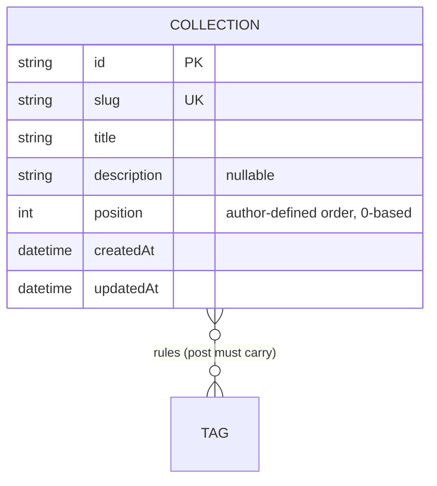

# Collection — aggregate root

A titled, described view over the posts, defined by tag rules. See the
[full ERD](./README.md) and [spec §4.4](../spec/functional.md#44-collections).

## Attributes

| Field | Type | Optional | Notes |
|---|---|---|---|
| `id` | string (cuid) | — | PK |
| `slug` | string | — | **Unique**, URL-safe; derived from the title. |
| `title` | string | — | Required. |
| `description` | string | ✓ | Shown on the home list and the collection page. |
| `position` | int | — | Place in the author-defined order (0-based, default 0). |
| `createdAt` / `updatedAt` | datetime | — | Timestamps. |

## Relations

- **Rules → Tags (0..*):** many-to-many via the implicit `CollectionTags` join. Each
  linked tag is one **rule**: a post must carry that tag.
- **Posts:** none stored. Membership is computed from the rules at read time.

## Invariants & rules

- A collection lists the **published, non-deleted** posts that carry **every** rule
  tag, newest first. With **no rules it lists every published post**
  ([§5.3](../spec/policies.md#53-relationships--integrity)).
- The post count shown for a collection is computed the same way, so drafts never
  show in it ([§5.1](../spec/policies.md#51-content-visibility)).
- Rule tags are given by name and matched or created exactly like a post's tags.
- Slug is **unique**, derived from the title, and follows a title change; a clash
  is rejected ([§5.2](../spec/policies.md#52-identifiers)).
- Collections are always listed by `position` ascending (creation time breaks a
  tie). A new collection takes the last position; reordering rewrites the
  positions of all collections in one transaction.
- Deleting a collection deletes only its rules. Deleting a tag removes the rules
  that named it (the collection then matches more posts).
