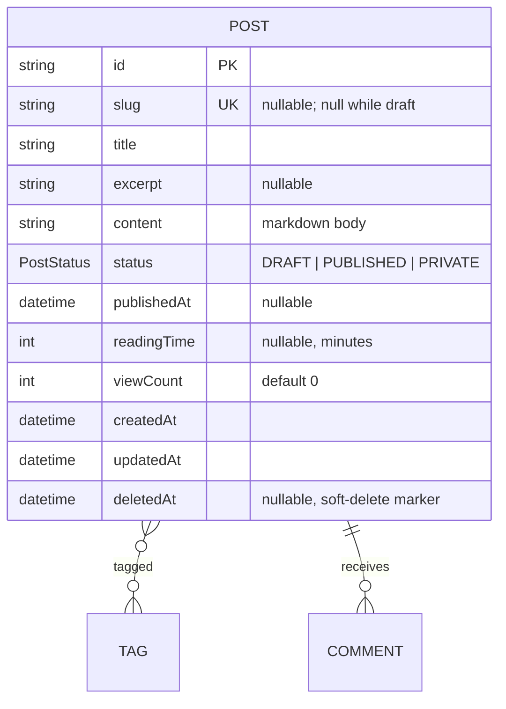

# Post — aggregate root

The central unit of content and the aggregate everything else references. See the
[full ERD](./README.md) and [spec §3](../spec/README.md#3-domain-concepts).

## Attributes

| Field | Type | Optional | Notes |
|---|---|---|---|
| `id` | string (cuid) | — | PK |
| `slug` | string | ✓ | **Unique** (nullable). `null` while draft; generated from the title when the post becomes published or private, and suffix-deduped on collision. URL-safe; may contain Hangul. |
| `title` | string | — | Required. |
| `excerpt` | string | ✓ | Short summary for list views. |
| `content` | string | — | Markdown; images embedded inline by reference. |
| `status` | `PostStatus` | — | `DRAFT` (default), `PUBLISHED`, or `PRIVATE` (finished, author-only). |
| `publishedAt` | datetime | ✓ | Stamped on first publish unless already set; **author-editable** afterwards. Never cleared by an edit. |
| `readingTime` | int | ✓ | Minutes (~200 wpm, min 1); computed on save. |
| `viewCount` | int | — | Default 0. |
| `deletedAt` | datetime | ✓ | Soft-delete marker; `null` = live. When set, the post is hidden everywhere and retained for recovery. |

## Relations

- **Tags (0..*):** many-to-many (`PostTags`) — the only grouping. Set by name on
  save; unknown names create tags.
- **Comments (0..*):** owned; `onDelete: Cascade`.

## Invariants & rules

- A post has **zero or more tags** and nothing else groups it
  ([§5.3](../spec/policies.md#53-relationships--integrity)).
- Slug is **service-managed**: `null` while the post is a draft, generated from
  the title on publish, and made **unique** by appending a numeric suffix on
  collision (never rejected). It may change when the title changes
  ([§5.2](../spec/policies.md#52-identifiers)).
- **A `PRIVATE` post is readable by the admin only.** Anonymous reads treat it as
  absent: `GET /posts/{slug}` is 404, and it is excluded from lists, tag counts
  and collection counts. Admin reads that ask for what is *visible* get
  `PUBLISHED` and `PRIVATE` together (never drafts)
  ([§5.1](../spec/policies.md#51-content-visibility)).
- `publishedAt` is stamped the first time a post becomes `PUBLISHED` **or**
  `PRIVATE`, and the slug exists in both states.
- **Drafts are private** — never listed or reachable by a reader on any surface,
  including by direct slug ([§5.1](../spec/policies.md#51-content-visibility)).
- Public listings are ordered newest-first by `publishedAt`.
- `publishedAt` is stamped with the current time the first time a post is
  published, unless the author already set one. The author may overwrite it on
  any update; it is never cleared (reverting to draft keeps it), and it does not
  affect visibility ([§5.1](../spec/policies.md#51-content-visibility)).
- Deletion is a **soft delete**: `remove` sets `deletedAt` and rewrites the slug
  to release it, rather than deleting the row. A post with `deletedAt` set is
  excluded from every read (lists, detail, tag counts and tag pages) for
  readers and the author alike, and its comments go with it. The `onDelete:
  Cascade` on comments only matters if a row is ever physically purged
  ([§5.3](../spec/policies.md#53-relationships--integrity)).

## Indexes

`@@index([status, publishedAt])`;
unique on `slug` (nullable — Postgres allows many `NULL`s, so drafts don't collide).
