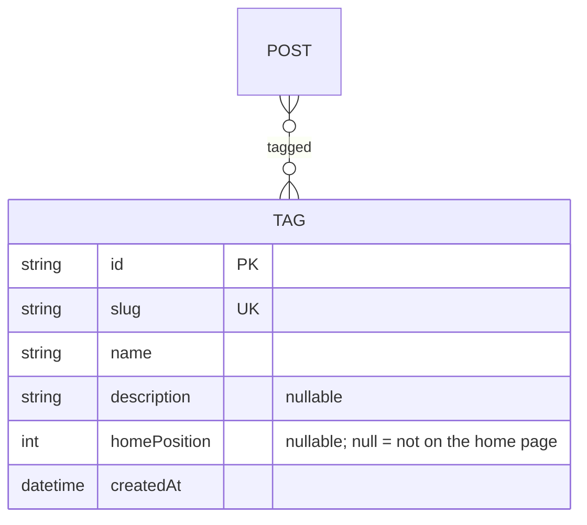

# Tag — aggregate root

The only grouping of posts: a named, optionally described label applied
across many posts. The author may show a tag on the home page. See the
[full ERD](./README.md).

## Attributes

| Field | Type | Optional | Notes |
|---|---|---|---|
| `id` | string (cuid) | — | PK |
| `slug` | string | — | **Unique**, URL-safe; derived from the name. |
| `name` | string | — | Display name, rendered as a badge. Author-editable; renaming does not change the slug. |
| `description` | string | ✓ | Shown on the tag's page and in the home page's list. |
| `homePosition` | int | ✓ | 0-based place in the home page's tag list. **Null means the tag is not shown there.** |
| `createdAt` | datetime | — | Timestamp. **No `updatedAt`** on this model. |

## Relations

- **Posts (0..*):** many-to-many via the implicit `PostTags` join. A post may carry
  zero or more tags; a tag spans many posts.

## Invariants & rules

- Slug is **unique** and URL-safe ([§5.2](../spec/policies.md#52-identifiers)).
- A tag typed on a post is matched to an existing tag by **name
  (case-insensitive) or slug**; only an unmatched name creates a tag.
- Tag pages and tag counts cover **published and private posts, never drafts**
  ([§4.3](../spec/functional.md#43-tags)); the public tag bar orders tags by that
  count, highest first, and skips tags whose count is 0.
- **Home tags** are the tags with a `homePosition`, listed on the home page in
  that order ([§4.3](../spec/functional.md#43-tags)). Switching a tag on puts it
  last; reordering rewrites every home tag's position at once.
- Deleting a tag removes its join rows only; posts are untouched.
